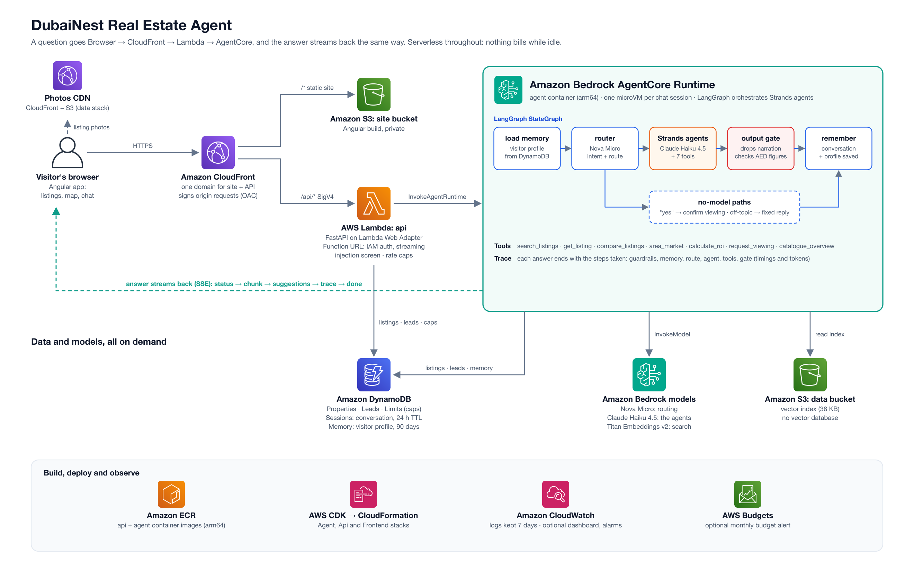

# DubaiNest AgentCore

An AI real-estate assistant for buying property in Dubai, built to cost almost nothing while idle. **LangGraph orchestrates Strands agents** on Amazon Bedrock AgentCore Runtime, with conversation and long-term memory in DynamoDB, behind a Lambda Function URL and CloudFront. No servers, load balancers or NAT gateways run between questions: idle cost is about $0.10–0.30 a month, and a question costs about $0.007.



| Layer | Technology |
| --- | --- |
| Compute (API, guardrails, relay) | AWS Lambda (Function URL, response streaming) behind CloudFront |
| Orchestration: routing, state, guardrails, memory | LangGraph |
| Agents | Strands Agents (five specialists, Claude Haiku 4.5 on Bedrock) |
| Agent hosting | Amazon Bedrock AgentCore Runtime |
| Memory | DynamoDB: LangGraph checkpointer (conversation) + store (visitor profile) |
| Search | Titan Text Embeddings v2 + keyword ranking over a small NumPy index in S3 |
| Infrastructure | AWS CDK (TypeScript) |
| Observability | Agent trace under each chat answer; CloudWatch logs, optional dashboard, alarms and budget |
| UI | Angular 21 + Tailwind |

**What it does:** search listings in plain language ("something with a beach and lagoons for my family"), compare them, explain market trends, work out yields, mortgage and cash flow, and take viewing requests. Answers stream sentence by sentence, and every AED figure is checked against a tool result before the visitor sees it. Under each answer the chat shows an **agent trace**: the route taken, the agent, each tool call, the output gate, timings and token counts.

## Layout

```
dubainest-agentcore/
├── frontend/   # Angular 21 + Tailwind: listings, filters, map, detail page, chat panel
├── api/        # FastAPI: listings, enquiries, property-intro, chat relay, caps (+ tests, Dockerfile)
├── agent/      # LangGraph graph + Strands agents (specialists/), memory, AgentCore entrypoint (+ tests)
├── evals/      # evals against Bedrock: routing, grounding, cost, memory
├── data/       # mock_properties.py (20 listings), area_stats.json (market notes)
├── infra/      # CDK: AgentStack, ApiStack, FrontendStack, ObservabilityStack
├── scripts/    # deploy.sh, smoke.sh, build_index.py, seed_properties.py, upload_photos.sh, invoke_agent.py
└── assets/     # architecture diagram
```

## Prerequisites

- An AWS account (region `us-east-1` by default) with **Bedrock model access** to Amazon Nova Micro, Anthropic Claude Haiku 4.5 and Amazon Titan Text Embeddings v2.
- Python 3.12, Node 20+, Docker (the Lambda and AgentCore images are built for arm64), the AWS CLI, and CDK bootstrapped once: `cd infra && npm ci && npx cdk bootstrap`.
- **Two DynamoDB tables** that this app reads and writes but does not create, so their data outlives any redeploy. Create them once and seed the listings:

  ```bash
  aws dynamodb create-table --table-name dubainest-properties-dev --billing-mode PAY_PER_REQUEST \
    --attribute-definitions AttributeName=propertyId,AttributeType=S \
    --key-schema AttributeName=propertyId,KeyType=HASH
  aws dynamodb create-table --table-name dubainest-leads-dev --billing-mode PAY_PER_REQUEST \
    --attribute-definitions AttributeName=leadId,AttributeType=S \
    --key-schema AttributeName=leadId,KeyType=HASH
  .venv/bin/python scripts/seed_properties.py --table dubainest-properties-dev   # after the venv below
  ```

  Other names: set `DYNAMODB_PROPERTIES_TABLE` / `DYNAMODB_LEADS_TABLE` locally and pass `-c propertiesTable=… -c leadsTable=…` to CDK.
- **Listing photos (optional).** Listings store photo file names; the API prefixes them with `MEDIA_BASE_URL` (e.g. `https://<your-cdn>/media/photos`). Upload the files with `scripts/upload_photos.sh --bucket <your-bucket> --dir <photos>`. Without it, everything works but the photos don't load.

## Run locally

```bash
# once
python3.12 -m venv .venv && .venv/bin/pip install -r requirements-dev.txt
cp .env.example .env                        # set MEDIA_BASE_URL if you have photos
.venv/bin/python scripts/build_index.py     # vector index for search (20 Titan calls; rerun when listings change)

# api on :8000 (what frontend/src/environments/environment.ts points at)
.venv/bin/uvicorn api.app:app --port 8000 --env-file .env --reload

# UI on :4200, in a second terminal
cd frontend && npm ci && npm start
```

Open http://localhost:4200. Locally the chat runs the agent inside the api process (`AGENT_MODE=local`), using your AWS credentials for Bedrock and DynamoDB. The caps are off locally (no `LIMITS_TABLE`), and memory is in-process unless `SESSIONS_TABLE` / `MEMORY_TABLE` are set.

| Route | What it does |
| --- | --- |
| `GET /api/properties` (+ area, developer, type, bedrooms, minPrice, maxPrice) | Listings from the Properties table, one Scan per instance per 60 s |
| `GET /api/properties/facets` | Filter values, same cache |
| `GET /api/properties/{id}` | One listing, 404 if unknown |
| `POST /api/enquiries` | The detail page's enquiry form → Leads table (`source: enquiry_form`), 201. Name and email required; phone and message optional |
| `GET /api/chat/property-intro/{id}` | Templated intro for the open listing, no model call |
| `POST /api/chat` (prompt, property_id, history, session_id, visitor_id) | Injection screen, caps, then the agent's SSE events (answer, suggestions, trace), relayed unchanged |

## The agent: LangGraph orchestrates, Strands agents answer

```
START → load_memory → router ─┬→ property_agent ─┐
          (store)   (Nova Micro)├→ market_agent ───┤   Strands agents (Claude Haiku 4.5):
                              ├→ roi_agent ──────┤   tools + output gate
                              ├→ viewing_agent ──┼→ remember → END
                              ├→ general_agent ──┤     (store + checkpointer)
                              ├→ confirm_viewing ┤   no model: "yes" saves the lead
                              └→ off_topic ──────┘   no model: fixed reply
```

- **LangGraph** ([agent/graph.py](agent/graph.py)) owns the control flow: memory in and out, routing, which agent answers, the viewing confirmation and the off-topic reply.
- **Router** ([agent/nodes/router.py](agent/nodes/router.py)): one Nova Micro call with structured output (`intent`, `second_intent`, `confidence`); a keyword router below 0.6 confidence or on error; a question naming a listing is never off-topic. A yes/no to a pending viewing goes straight to `confirm_viewing` with no model call. Questions with two intents (search + ROI, search + market, market + ROI) give one agent both toolsets.
- **Strands agents** ([agent/specialists/](agent/specialists/)): a fresh `strands.Agent` per question, with the conversation as its messages and only its specialist's tools ([tools.py](agent/specialists/tools.py)):

  | Agent | Tools |
  | --- | --- |
  | property | `search_listings` (filters + hybrid vector/keyword ranking), `get_listing`, `compare_listings` |
  | market | `area_market`, `get_listing` |
  | roi | `calculate_roi` (deterministic yield, mortgage, cash flow, payback), `search_listings`, `get_listing` |
  | viewing | `request_viewing` (checks details against what the visitor typed; holds the request until "yes"), `get_listing` |
  | general | `catalogue_overview`, `get_listing` |

  Tools return every derived figure (budget gaps, comparisons, monthly and annual ROI), so the model never does arithmetic.
- **Output gate** ([agent/specialists/gate.py](agent/specialists/gate.py)): narration before tool calls is dropped and replaced by `status` events ("Searching listings…"); the answer streams sentence by sentence, each checked first: every AED figure must come from this turn's tool results, earlier (already checked) answers or the visitor's words. A failing sentence is never sent; the stream stops with a safe line and the agent is cancelled.
- **Memory** ([agent/memory.py](agent/memory.py), [nodes/memory_nodes.py](agent/nodes/memory_nodes.py)): the conversation per chat session through LangGraph's checkpointer (`DynamoDBSaver`, 24 h); the visitor profile through LangGraph's store (`DynamoDBStore`, 90 days): budget, areas, bedrooms, types, purpose, first name, listings seen. Extracted by code, never email or phone. Memory is available, not imposed: the budget reaches the agent only when the question is about budget, other preferences only when the question refers to the visitor.
- **Events** ([agent/stream.py](agent/stream.py)): `status` → `chunk`… → `suggestions` → `trace` → `done`, or `error` with a safe message.
- **Agent trace** ([agent/tracing.py](agent/tracing.py)): under each answer the chat shows the intent, the agent and the tools as pills, and a collapsed list of the steps taken: the API's injection screen and caps, memory, the route (model, confidence, any keyword override), the Strands agent (model calls, tokens), each tool call with its timing, and the output gate. It is the `trace` event, built from the entries every graph node already records. The site is public, so a step carries names, counts and timings only: no prompts, tool arguments or results, or profile values. Replies the API writes itself (refusals, caps) have no trace. `SHOW_TRACE=off` on the agent turns it off.

Market figures in [data/area_stats.json](data/area_stats.json) are hand-written notes dated June 2026, marked unverified; agents quote their date.

```bash
# in-process (Bedrock calls; listings from DynamoDB, or LISTINGS_SOURCE=seed)
.venv/bin/python -m agent.cli "2 bed apartments under 3M"
.venv/bin/python -m agent.cli --property 10 --trace "What's the expected ROI?"   # the steps; --trace-raw for the raw entries
.venv/bin/python -m agent.cli --chat          # a conversation; /new starts a session, same visitor

# evals against Bedrock (about 130 model calls, a few cents; leads are not written)
.venv/bin/python -m evals            # routing ≥ 90%, grounding 20/20, ≤ 4 calls on 95%, memory 5/5
.venv/bin/python -m evals memory -v
```

Last run: routing 44/44, grounding 20/20 (output gate blocked nothing), every question in 4 model calls or fewer (median 3), about 6,100 input / 320 output tokens and **$0.0068 per question**, 3.1 s average; memory 5/5 (a follow-up with no browser history, a viewing confirmed by "yes", the budget recalled in a new session).

## Tests and checks

```bash
.venv/bin/pytest -q                         # api, chat SSE contract, agent with a fake Strands agent, memory on moto DynamoDB; no AWS
.venv/bin/ruff check api agent evals scripts data
cd frontend && npm run build
cd infra && npx cdk synth
```

## Deploy

```
browser ─▶ CloudFront ─┬─ /*      ─▶ S3 (Angular build)
                       └─ /api/*  ─▶ Lambda Function URL (AWS_IAM, RESPONSE_STREAM)
                                       └─ api/ image: FastAPI under Lambda Web Adapter
                                            ├─ DynamoDB (Properties, Leads, limits)
                                            └─ InvokeAgentRuntime ─▶ AgentCore Runtime (agent/ image)
                                                                       ├─ Bedrock
                                                                       └─ DynamoDB (sessions, memory)
```

```bash
scripts/deploy.sh            # everything: AgentStack, upload the index, ApiStack + FrontendStack, upload the UI, smoke test
scripts/deploy.sh --agent    # AgentCore Runtime only, then one test question straight to AgentCore
scripts/deploy.sh --infra    # api Lambda + CloudFront (and AgentStack, which they need)
scripts/deploy.sh --site     # UI only
scripts/smoke.sh             # checks the live site
```

Docker must be running. CDK asks before IAM changes, which needs a terminal; `REQUIRE_APPROVAL=never` skips that (review `cdk diff` first). Set `MEDIA_BASE_URL` before deploying if you have photos. The live URLs are written to `.deploy/outputs.env`, which is gitignored.

- **api Lambda** ([infra/lib/api-stack.ts](infra/lib/api-stack.ts)): the same FastAPI app as local, packaged by [api/Dockerfile](api/Dockerfile) (arm64, Python 3.12, Lambda Web Adapter so `POST /api/chat` streams). 512 MB, 60 s timeout, reserved concurrency 3, logs kept 7 days. Its role can scan Properties, put items in Leads, use its limits table and invoke the one AgentCore runtime.
- **Function URL is IAM-only.** CloudFront signs every `/api/*` request (origin access control), so the URL can't be called directly. Lambda needs a body hash on signed POSTs, which CloudFront can't compute, so the UI sends `x-amz-content-sha256` itself ([signed-body.ts](frontend/src/app/services/signed-body.ts)).
- **SPA routing** is a CloudFront Function on the S3 behaviour (paths without a file extension → `index.html`), not distribution-wide error pages, so the api's 403/404 reach the browser as JSON.
- **Chat relay** ([api/chat_relay.py](api/chat_relay.py)): injection screen, then the caps, then `InvokeAgentRuntime` with one AgentCore session per chat window. AgentCore's SSE bytes are passed through unchanged as they arrive (read with `read1()`; boto3's `iter_lines()` would buffer a short answer until the end).
- **Caps** ([api/limits.py](api/limits.py)): 20 questions a minute per visitor IP and 200 a day for the whole site (about $1.30/day worst case), as atomic counters in `dubainest-agentcore-limits-<env>`. IPs are stored only as a salted hash, taken from `CloudFront-Viewer-Address` (set by CloudFront; `X-Forwarded-For` is never trusted). Five screened injection attempts in 10 minutes put that IP in a cooldown. A capped question gets a polite reply and never wakes AgentCore. Change with `-c dailyQuestionCap=… -c perIpPerMinute=…`.
- **AgentCore Runtime** ([infra/lib/agent-stack.ts](infra/lib/agent-stack.ts), [agent/main.py](agent/main.py), [agent/Dockerfile](agent/Dockerfile)): `BedrockAgentCoreApp` streaming SSE from an async-generator entrypoint; arm64 image with LangGraph + Strands; PUBLIC network mode (no VPC, no NAT); sessions end after 5 idle minutes. Its role can invoke the three models, Scan Properties, PutItem Leads (confirmed viewings), read the index object and use its two memory tables (`dubainest-agentcore-sessions-<env>`, `dubainest-agentcore-memory-<env>`, on demand, with TTLs).
- **Latency:** first status ~0.3–1 s and first text ~2–4 s when warm; the first question after idle (Lambda and a new microVM start) takes 6–10 s to first text.
- **Monitoring and budget (optional):** `cd infra && npx cdk deploy DubaiNestAgentCoreObservabilityStack -c alertEmail=you@example.com` adds a dashboard, alarms and a monthly AWS Budget (`-c monthlyBudgetUsd=10`).
- **Idle cost:** ECR images, S3 and 7-day logs, about $0.10–0.30 a month; Lambda, CloudFront, DynamoDB on demand and AgentCore bill only when used.

```bash
# talk to the deployed AgentCore Runtime directly (skips CloudFront and the Lambda)
.venv/bin/python scripts/invoke_agent.py "2 bed apartments under 3M"
.venv/bin/python scripts/invoke_agent.py --events --property 10 "Expected ROI?"   # raw events + timings

# the agent container locally (port 8080)
docker buildx build --platform linux/arm64 -f agent/Dockerfile -t dubainest-agent .
.venv/bin/python -m agent.main                 # or run the entrypoint without Docker
```
