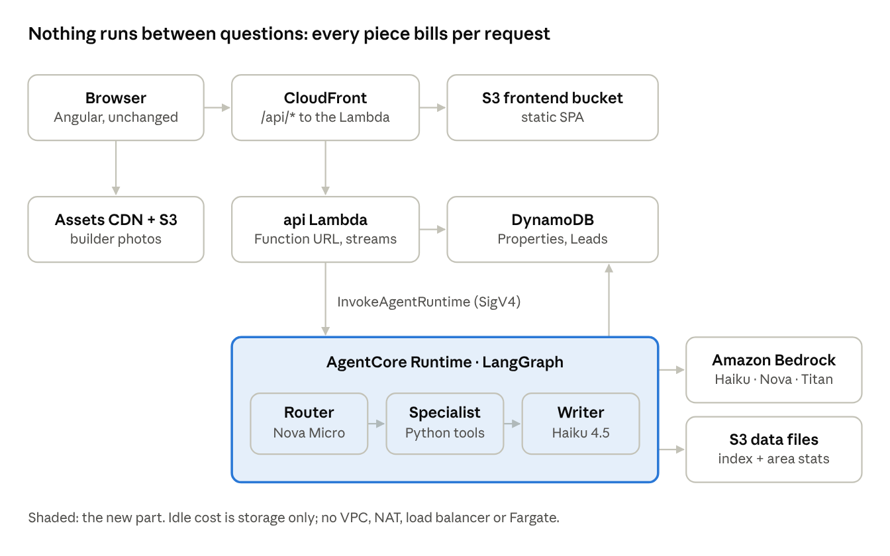

# DubaiNest AgentCore — Backend Spec

Nov 11, 2026 · Anu · Live version: https://claude.ai/artifact/JsPaBpwNNqjxHqi4MxLmrf

## 1. Goal

Rebuild the DubaiNest AI backend as a fully on-demand stack that costs roughly nothing while idle and a fraction of a cent per question. The new project is a clone of `dubainest-ai`. The Angular frontend and the builder photos in S3 stay as they are; everything behind `/api/*` is replaced.

- **Orchestration:** a real LangGraph `StateGraph`. The current `graph.py` routes with a hand-written if/elif, so this is also the first true LangGraph version.
- **Agent hosting:** Amazon Bedrock AgentCore Runtime (serverless microVMs, billed per second of active use).
- **Models:** Amazon Bedrock only, with a cheap model for routing and a mid-tier model for answers.
- **Cost target:** under $1/month idle, about $0.01 per question or less (§8).
- **Working name:** `dubainest-agentcore`, a new folder next to `dubainest-ai` in Agentic AI Learning.

## 2. What stays exactly the same

The Angular app is copied unchanged, so the new backend must serve the same six routes with the same shapes. `environment.prod.ts` keeps `apiUrl: ""`; CloudFront still owns `/api/*`, only its origin changes.

| Route | Used by | Response the UI expects | New home |
| --- | --- | --- | --- |
| `GET /api/properties` (+ area, developer, type, bedrooms, minPrice, maxPrice) | PropertyService | Property[] | api Lambda, DynamoDB |
| `GET /api/properties/facets` | filter dropdowns | areas, developers, types, bedrooms | api Lambda |
| `GET /api/properties/{id}` | detail page | Property | api Lambda |
| `POST /api/enquiries` | detail page form | EnquiryRead, 201 | api Lambda, Leads table |
| `GET /api/chat/property-intro/{id}` | chat opened on a property | intro + suggestions, templated, no LLM | api Lambda |
| `POST /api/chat` (prompt, property_id, history) | ChatService.streamChat | SSE lines of role, event_type, content | api Lambda, then AgentCore |

**SSE contract (must not change):** `event_type` is `status` ("Thinking..."), then `chunk` (text), then optionally `suggestions` (content is an array of up to 3 strings), then `done`; or `error` with a safe message. The current suggestions-marker parsing moves into the agent, so the Lambda only relays events.

**Also kept:**

- The assets bucket `dubainest-assets-ACCOUNT-us-east-1` and its CloudFront distribution for builder photos. The `MEDIA_BASE_URL` rewrite in `properties.py` moves into the api Lambda as is.
- The frontend bucket and distribution (its URL is kept out of this repo), or a fresh copy for the new project (§13).
- DynamoDB on-demand tables for Properties, Leads and Conversations. These already cost nothing at rest.
- The 20-property seed (`mock_properties.py`, `seed_properties.py`) and the regex prompt-injection screen in `agent_service.py`.
- **One catalogue change, made in both projects:** listing id `10` was Emaar's "Act One Act Two — Downtown Dubai" (image `Act One Act Two — Downtown Dubai.jpeg`). It is now DAMAC's "DAMAC Islands — Dubailand", a 4-bedroom off-plan townhouse with handover in 2028, using the image `Damac islands.jpeg`, which is already in the assets bucket under `media/photos/`. The id stays the same, so links to `/property/10` still work. The seed is now DAMAC 7, Emaar 8, Nakheel 5. `Dubailand` is a new area, so it appears as a new option in the area filter. The change is made in `dubainest-ai/backend/app/data/mock_properties.py` and carries over when step 1 copies the seed. The deployed Properties table and the RAG index need a re-seed to pick it up.

## 3. Review of the current stack

The current backend bills every hour it is deployed, which is why `demo-up.sh` and `demo-down.sh` exist. Everything always-on goes; only per-request services remain.

| Current piece (dubainest-ai) | Bills while idle? | New design |
| --- | --- | --- |
| VPC + NAT gateway (1 dev, 2 prod) | Yes, hourly + per GB | Removed. Lambda and AgentCore run outside a VPC. |
| Application Load Balancer | Yes, hourly | Removed. CloudFront calls a Lambda Function URL. |
| ECS Fargate service (0.5–1 vCPU, 1–2 tasks) | Yes, per task-hour | Removed. AgentCore Runtime bills only active seconds. |
| FastAPI + in-process ChromaDB warm-up on start | Inside Fargate | Replaced by a pre-built vector file loaded at agent start (§7). |
| OpenSearch Serverless (vector-stack, not deployed) | Yes; the repo notes about $11/day | Stays out. |
| Bedrock Guardrail (CfnGuardrail) | No, per text unit | Optional (§10). |
| DynamoDB on-demand, S3, CloudFront | No | Kept. |
| AWS Budget, alarms | No | Kept, retuned to $10/month. |

Two code issues are fixed on the way: intent routing becomes a real LangGraph graph instead of an if/elif chain, and the hard-coded "Dubai Market Context (June 2026)" in the system prompt moves to a dated data file the market agent reads.

## 4. Architecture

A question wakes three things in order (CloudFront, the api Lambda, then AgentCore), and all three stop billing compute when it is answered.



1. The browser POSTs `/api/chat` to the same CloudFront domain as today.
2. CloudFront forwards `/api/*` to the api Lambda's Function URL (origin access control, `RESPONSE_STREAM` mode). Non-chat routes are answered there from DynamoDB.
3. For chat, the Lambda runs guard_in and the caps, then calls `InvokeAgentRuntime` with a fresh `runtimeSessionId` per chat window.
4. AgentCore runs the LangGraph graph: memory, router, one Strands agent with its tools, the output gate. It reads listings, stats and memory and calls Bedrock.
5. The agent streams the UI's SSE events back; the Lambda relays them unchanged to the browser.

Region: us-east-1. AgentCore runs in public network mode, so no VPC or NAT gateway is needed. Its IAM role allows only Bedrock invoke on the three models (Nova Micro, Haiku 4.5, Titan v2), read on the index object and the Properties table, write on the Leads table, and read/write on its own two memory tables.

## 5. Agent design: LangGraph orchestrates, Strands agents answer

The project's headline design: **LangGraph** owns routing, state, memory and guardrails; each specialist is a **Strands** agent with its own tools; both run together in one **AgentCore Runtime** container. Strands answers the question, and LangGraph decides who answers, what they may say and what is remembered.

```
START → load_memory → router ─┬→ property_agent ─┐
                              ├→ market_agent ───┤   (Strands agents:
                              ├→ roi_agent ──────┤    tools + output gate)
                              ├→ viewing_agent ──┼→ remember → END
                              ├→ general_agent ──┤
                              ├→ confirm_viewing ┤   (no model: "yes" saves the lead)
                              └→ off_topic ──────┘   (no model: fixed reply)
```

**State** (`agent/state.py`): `prompt`, `property_id`, `visitor_id`, `property_context` (the listing open in the UI), `history` (the conversation, kept by the checkpointer), `profile` (long-term memory), `pending_viewing`, `intents`, `facts` (every tool result this turn), `answer`, `suggestions`, `trace`.

**Nodes**

| Node | Built with | What it does |
| --- | --- | --- |
| `load_memory` | LangGraph store | Loads the visitor's profile from long-term memory; resolves the open listing. |
| `router` | Nova Micro, structured output (langchain-aws) | `Route{intent, second_intent, confidence}`; low confidence falls back to the keyword router. A "yes"/"no" while a viewing request is pending goes to `confirm_viewing` with no model call. |
| `property_agent` | Strands + Claude Haiku 4.5 | Tools: `search_listings` (filters + hybrid vector/keyword ranking), `get_listing`, `compare_listings`. |
| `market_agent` | Strands | Tools: `area_market` (dated area stats), `get_listing`. |
| `roi_agent` | Strands | Tools: `calculate_roi` (deterministic yield, mortgage, cash-flow and payback maths), `search_listings`, `get_listing`. |
| `viewing_agent` | Strands | Tools: `request_viewing` (validates details, returns what is missing or holds the request for confirmation), `get_listing`. It never writes a lead itself. |
| `general_agent` | Strands | Tools: `catalogue_overview`, `get_listing`. |
| `confirm_viewing` | none | On "yes", writes the pending request to Leads; on "no", cancels it. |
| `off_topic` | none | The fixed "I specialise in Dubai real estate" reply. |
| `remember` | LangGraph store + checkpointer | Updates the visitor profile and appends the turn to the conversation. |

**Two intents** ("2BR in Marina and their yields"): the router's allowed pairs (search+ROI, search+market, market+ROI) give one agent the tools of both specialists, so there is still one answer and one stream.

**Tools are plain Python** (the existing listing search, ROI maths, area stats), wrapped with Strands `@tool`. Every call's result is recorded into `facts`, which the output gate checks against.

**Output gate.** Strands streams everything the model writes, including narration such as "Let me search…" before a tool call. Agent output reaches the browser only through the gate:

1. Text written before or between tool calls is held, and discarded when a tool call follows. Each tool call sends a `status` event instead ("Searching listings…").
2. The final answer is released sentence by sentence (or table row by row). Each sentence is checked first: every AED figure in it must appear in a tool result this turn or in the user's own words.
3. A sentence that fails stops the stream. The user gets a safe line instead ("I couldn't verify one figure…"), the agent is cancelled, and the trace records the figure. The bad sentence never reaches the browser.
4. The `<<SUGGESTIONS>>` block is held back and becomes the `suggestions` event.

The gate cannot recall sentences already sent, but a wrong figure can only appear in the sentence that contains it, and that sentence is always checked before it goes out.

**Streaming:** the AgentCore entrypoint is an async generator over `graph.astream(..., stream_mode=["custom", "values"])`; the UI's events are unchanged: `status`, `chunk`…, `suggestions`, `done`.

**Model calls per question:** router 1 + Strands loop 2 (pick tools, then answer); 3 in most cases, 4 if the agent needs a second round of tools.

## 6. Why Strands inside LangGraph

Both frameworks are free (Apache-2.0 / MIT); you pay for model tokens and runtime seconds. They do different jobs here:

| | LangGraph | Strands Agents |
| --- | --- | --- |
| Role in this project | Orchestration: routing, conditional edges, state, memory, guardrails | The specialists: a model plus tools, running its own tool loop |
| Why it fits | Explicit, testable control flow; checkpointer and store interfaces with DynamoDB backends (`langgraph-checkpoint-aws`) | Bedrock-native through the normal IAM role; `@tool` from plain Python functions; built alongside AgentCore |
| Already used in | payroll-ai (LangGraph in Lambda) | payroll-ai-strands (Strands on AgentCore, orchestrator in plain Python) |

Combining them is the point of this project: neither earlier project used both. The OpenAI Agents SDK is not used; on Bedrock it adds a second vendor and no benefit.

**Cost of the choice.** A Strands agent spends one model call choosing tools before it answers, so a question costs 3–4 model calls instead of the 2 of a fixed router → writer pipeline, about $0.005–0.008 instead of $0.003–0.004. That stays inside the ~$0.01 target (§8) and buys model-chosen tools, multi-step answers and a cleaner agent per specialist.

## 7. Data, RAG and memory

With 20 listings, every store can be a file or an on-demand table. Nothing needs a server running.

- **Listings:** the DynamoDB Properties table stays the source of truth for the api Lambda. The agent loads the same 20 items once per container start (one Scan) and keeps them in memory.
- **Vector search:** `scripts/build_index.py` embeds each listing with Titan Text Embeddings v2 and writes `listings_index.npz` (vectors + IDs) to S3. The agent loads it on first use and ranks by cosine similarity in NumPy, blended with keyword overlap. Each descriptive question costs one query embedding and no vector database. If the corpus grows past a few thousand chunks, switch to S3 Vectors as in payroll-ai-strands.
- **Market data:** `data/area_stats.json` holds per-area price per sq ft, yield range and transaction counts, each with an as-of date. Refreshing it is a manual task for now.
- **Leads and enquiries:** the existing DynamoDB Leads table, written by the api Lambda (enquiry form) and `confirm_viewing` (confirmed viewings).
- **Photos:** not touched by the backend except for the MEDIA_BASE_URL rewrite.

**Memory: two kinds, both in DynamoDB, both through LangGraph's own interfaces** (`langgraph-checkpoint-aws`):

| | Conversation memory | Long-term memory |
| --- | --- | --- |
| What | The chat so far, a pending viewing request | The visitor's preferences: budget, areas, bedrooms, property types, developers, purpose, first name, listings looked at |
| LangGraph piece | Checkpointer: `DynamoDBSaver`, `thread_id` = chat session | Store: `DynamoDBStore`, namespace `("visitor", visitor_id)` |
| Table | `dubainest-agentcore-sessions-<env>` (PK/SK, TTL `ttl`) | `dubainest-agentcore-memory-<env>` (PK/SK, TTL `expires_at`) |
| Kept for | 24 hours | 90 days since last use |
| Key from the browser | `session_id`: new per chat window | `visitor_id`: random ID in localStorage, no login |

- The profile is extracted by code, not by a model: the same filter parser that reads "2BR in Marina under 3M" updates the profile, so memory adds no model calls. Contact details (email, phone) never go into memory; they go only to Leads, after confirmation.
- Agents see the profile as context ("Known from earlier visits: budget up to AED 3,000,000, Dubai Marina, 2 bedrooms"), so "anything new in my budget?" works on a later visit.
- The browser still sends its last turns; they seed the conversation only when the server has none for that session (expired, or a local restart).
- AgentCore Memory is not used: it bills per event, and DynamoDB on demand costs fractions of a cent at this traffic.
- Locally and in tests the same graph uses LangGraph's in-memory saver and store (no `SESSIONS_TABLE` / `MEMORY_TABLE` set).

## 8. Cost: pay only when you ask

**Estimate: about $0.005–0.008 per question with Haiku-powered Strands agents, and under $0.30/month idle.** At 100 questions a month that is roughly $1 in total. Model tokens are about 90% of the per-question cost; AgentCore compute is a rounding error. Prices are us-east-1 on-demand as published in 2026; re-check them before the first deploy.

**Per question** (assumes ~600-token router prompt and a Strands agent making 2 Haiku calls of ~2,500 input tokens each, ~400 output tokens in total)

| Item | Rate used | Est. per question |
| --- | --- | --- |
| Router, Nova Micro | $0.035 in / $0.14 out per 1M tokens ([source](https://avahi.ai/?p=23189)) | $0.00003 |
| Strands agent, Claude Haiku 4.5 (2 calls) | $1 in / $5 out / $0.10 cache read per 1M ([source](https://llmgateway.io/models/claude-haiku-4-5/aws-bedrock)) | $0.005–0.008 |
| Memory, DynamoDB on demand (~2 reads, ~3 writes) | $0.125 / $0.625 per 1M request units | under $0.00001 |
| Query embedding, Titan v2 | ~50 tokens | under $0.00001 |
| AgentCore Runtime | $0.0895 per vCPU-hour, $0.00945 per GB-hour ([source](https://venturebeat.com/ai/aws-unveils-bedrock-agentcore-a-new-platform-for-building-enterprise-ai-agents-with-open-source-frameworks-and-tools)); Runtime v2 rates reported at $0.1276 and $0.0169 ([source](https://www.eesel.ai/blog/bedrock-managed-agents-pricing)) | $0.0001–0.0004 |
| api Lambda (streams ~10 s at 512 MB) | free tier | $0 |
| **Total** | | **~$0.005–0.008** |

With Sonnet-tier answers instead of Haiku, expect roughly 3×: about $0.015 per question.

AgentCore Runtime bills per second of actual CPU and peak memory, and I/O wait such as waiting on Bedrock is not charged for CPU ([AWS pricing](https://aws.amazon.com/bedrock/agentcore/pricing/)). That is what makes it suit a chatbot that is idle almost all the time.

**Idle per month (approximate):** ECR image (~1 GB) about $0.10; S3 for photos and the frontend a few cents; DynamoDB storage, CloudFront and Lambda inside free tiers; CloudWatch Logs with 7-day retention a few cents. Total under $0.30.

**Kept out on purpose:** NAT gateway, ALB, Fargate, OpenSearch Serverless, Bedrock Knowledge Bases, AgentCore Memory and Gateway, provisioned concurrency, WAF and Secrets Manager. Each one alone would cost more than the whole stack.

**Guards against a surprise bill** (the chat endpoint is public):

- A daily question cap in the api Lambda, 200/day, using an atomic DynamoDB counter. Worst case is about $1/day.
- Per-IP limit, 20/min, also a DynamoDB counter with TTL. It replaces slowapi, which cannot share state across Lambda instances.
- Reserved concurrency of 3 on the api Lambda, `max_tokens` 600 per agent answer, 4 model turns per Strands agent, and the existing 2,000-character prompt cap.
- AWS Budget of $10/month, alerts at 50%, 80% and 100%.

## 9. Repository layout

The new folder is a copy of `dubainest-ai` with `backend/`, `agents/` and `docker-compose.yml` replaced. Docs, scripts and the frontend carry over.

```
dubainest-agentcore/
├── frontend/            # copied unchanged (Angular 17 + Tailwind)
├── api/                 # Lambda: properties, facets, enquiries, property-intro, chat relay
│   ├── app.py           # FastAPI app, run by Lambda Web Adapter (streaming)
│   ├── chat_relay.py    # guard_in, caps, InvokeAgentRuntime, SSE pass-through
│   ├── properties.py    # moved from backend/app (incl. MEDIA_BASE_URL rewrite)
│   └── Dockerfile
├── agent/               # AgentCore Runtime container (arm64)
│   ├── main.py          # BedrockAgentCoreApp entrypoint, async generator
│   ├── graph.py         # StateGraph build + compile
│   ├── state.py
│   ├── nodes/           # load_memory, router, agent nodes, confirm_viewing, remember
│   ├── specialists/     # Strands agents: prompts, @tool wrappers, output gate
│   ├── memory.py        # DynamoDBSaver / DynamoDBStore (or in-memory locally)
│   ├── tools/           # listings, vector_index, area_stats, leads
│   ├── prompts.py
│   └── Dockerfile
├── data/                # area_stats.json, seed properties
├── scripts/             # seed_properties, build_index, deploy, smoke
├── evals/               # routing, contract, answer-grounding cases
├── infra/               # CDK (TypeScript): data, api, agent, frontend, observability stacks
└── docs/                # this spec, ADRs, architecture diagram
```

`agent/graph.py` can also run in-process, with no AgentCore, so local dev and evals need only AWS credentials for Bedrock (`AGENT_MODE=local`).

## 10. Guardrails and evals

Cheap checks run in the Lambda before any agent starts, so blocked or off-topic input never reaches AgentCore.

**Guardrails**

- **guard_in (api Lambda, free):** the regex injection screen (a calm, non-accusatory refusal; a visitor with 5 screened prompts in 10 minutes gets that refusal for everything until the window ends), the 2,000-character cap, the daily cap and the per-IP limit.
- **off_topic route (graph, one Nova Micro call):** fixed reply, no agent runs.
- **Output gate (graph, free):** every sentence an agent writes is checked before it is sent: its AED figures must come from this turn's tool results or the user's words. A failing sentence stops the stream (§5). Narration before tool calls never reaches the user.
- **Tool limits:** each Strands agent is capped at 4 model turns; tools are read-only except `request_viewing`, which only holds a request.
- **Viewing writes:** a lead is saved only by `confirm_viewing`, after an explicit "yes" to a pending request. Contact details must appear in the user's own messages (the tool rejects invented ones). Memory never stores email or phone.
- **Bedrock Guardrail:** optional. It bills per text unit; keep it off in v1 and enable it if the demo goes public beyond your portfolio.

**Evals** (`evals/`, run locally against the in-process graph)

| Suite | Checks | Gate |
| --- | --- | --- |
| Routing | ~40 labelled prompts, intent matches | 90%+ before deploy |
| SSE contract | event order and shape match what `chatbot.component.ts` parses | must pass |
| Grounding | every AED number in the answer appears in a tool result; the gate blocked nothing | must pass on 20 fixed cases |
| Cost | tokens and model calls per question from the trace | 4 calls or fewer on 95% of cases |
| Memory | a follow-up without browser history uses the session; a new session for the same visitor uses the profile; the viewing flow saves one lead after "yes" | must pass |
| Answer quality (on demand) | LLM-as-judge on ~20 cases, as in payroll-ai-strands | report only |

## 11. Build plan

Eight steps; the first four run entirely on your laptop with only Bedrock calls.

| Step | Delivers | Done when |
| --- | --- | --- |
| 1 | Copy `dubainest-ai` to `dubainest-agentcore`, `git init`, remove backend/agents/infra stacks for VPC, ALB, ECS | frontend builds unchanged |
| 2 | `api/` with properties, facets, enquiries, property-intro (no chat yet) against the existing DynamoDB tables | listings, filters and detail pages work locally |
| 3 | `agent/` graph with router and specialists, run in-process; rebuilt with Strands agents, output gate and memory (§5, §7) | routing, grounding and memory evals pass |
| 4 | `api/chat_relay.py` streaming in local mode, plus `build_index.py` | chat works end to end in the browser on localhost |
| 5 | CDK: api Lambda + Function URL, CloudFront `/api/*` behaviour switched to it | listings live on CloudFront, no ALB |
| 6 | CDK or starter toolkit: AgentCore Runtime (public network), ECR image, IAM | `InvokeAgentRuntime` streams from the CLI |
| 7 | Wire the relay to AgentCore, caps and budget | chat live; smoke test passes |
| 8 | Destroy the old dubainest-ai backend stacks; cost check after 7 days | Cost Explorer shows no hourly charges |

## 12. Risks to verify at build time

- **Browser cannot call AgentCore directly.** InvokeAgentRuntime needs SigV4 or a JWT, so the api Lambda relay is required. Confirm the Function URL in `RESPONSE_STREAM` mode passes AgentCore's stream through without buffering; payroll-ai-strands already does this, so reuse its setup.
- **Python Lambda streaming** needs Lambda Web Adapter (or a Node.js relay). Check payroll-ai-strands for the version that works.
- **CloudFront to Function URL** with origin access control: POST bodies need the `x-amz-content-sha256` header handled; test the chat POST early.
- **Cold starts:** the first question after idle pays AgentCore microVM start plus loading the index. Measure it; if it is above ~5 s, the `status` event covers it in the UI.
- **CDK coverage for AgentCore:** confirm the CloudFormation resource for AgentCore Runtime in the current aws-cdk-lib; fall back to the AgentCore starter toolkit for that one resource.
- **Runtime v2 pricing:** two published rate sets exist (§8). Re-check before deploy; either way the amount is fractions of a cent.
- **Model access:** Haiku 4.5 and Nova Micro must be enabled in us-east-1, via inference profiles like the current `bedrockModelArn`.
- **Market data freshness:** `area_stats.json` goes stale; agents must quote its as-of date.

## 13. Decisions needed

| # | Question | Proposed |
| --- | --- | --- |
| 1 | Agent SDK inside LangGraph | **Strands** for every specialist; LangGraph orchestrates (revised 2026-11-14) |
| 2 | Answer model | Claude Haiku 4.5; Sonnet as a config switch |
| 3 | Router model | Nova Micro; Haiku if routing evals fall below 90% |
| 4 | IaC | CDK (TypeScript), to match dubainest-ai; payroll-ai-strands used Terraform |
| 5 | Share or copy AWS resources | Share the assets bucket and DynamoDB tables; new frontend distribution so both versions can run side by side |
| 6 | Old dubainest-ai stacks | Destroy the backend, network and observability stacks after step 7 |
| 7 | Folder and repo name | `dubainest-agentcore` |
| 8 | Memory | Both: conversation (LangGraph checkpointer) and long-term visitor profile (LangGraph store), in DynamoDB |
| 9 | Agent output | Streamed through the output gate, sentence by sentence; not held until complete |

Next: once these are settled, start build step 1.
