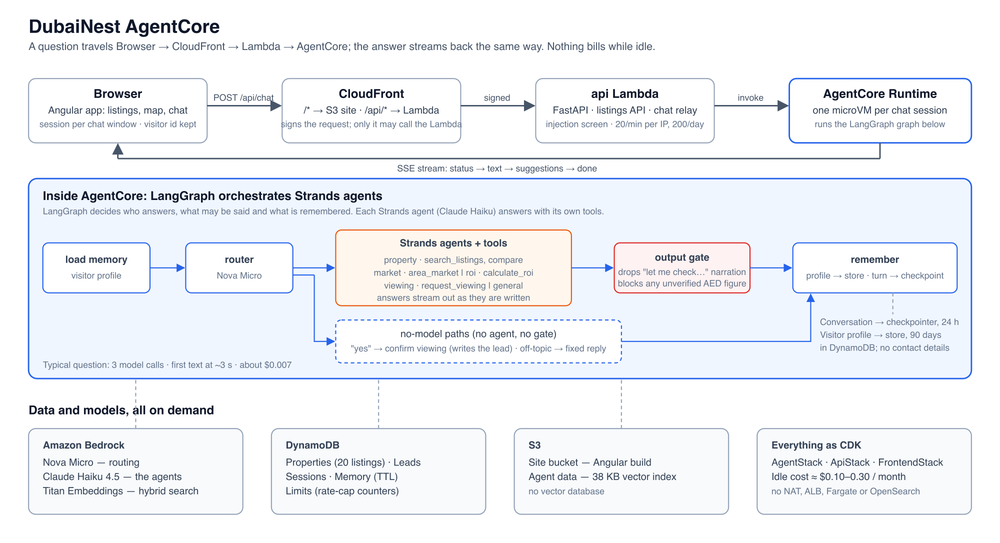

# Interview kit

| File | What it is |
| --- | --- |
| [architecture-simple.svg](architecture-simple.svg) · [architecture-simple.png](architecture-simple.png) | **Start here.** One-page overview: request path, the graph inside AgentCore, data and models |
| [architecture.svg](architecture.svg) · [architecture.png](architecture.png) | Detailed diagram: adds guardrails, container, cost controls, IaC and eval numbers |
| [interview-prep.md](interview-prep.md) | Pitch, decisions and trade-offs, numbers, a code walkthrough that follows one question through every file, problems solved, likely questions with answers |
| [demo-walkthrough.md](demo-walkthrough.md) | A 12–15 minute end-to-end demo script with what to say, fallbacks, shorter versions and cleanup |

The PNGs are rendered from the SVGs: `rsvg-convert -w 2000 architecture-simple.svg -o architecture-simple.png` (same for `architecture.svg`).
